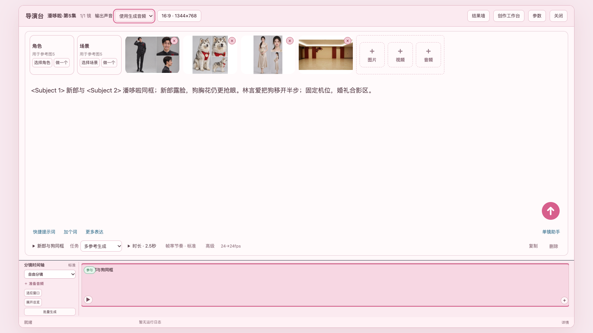
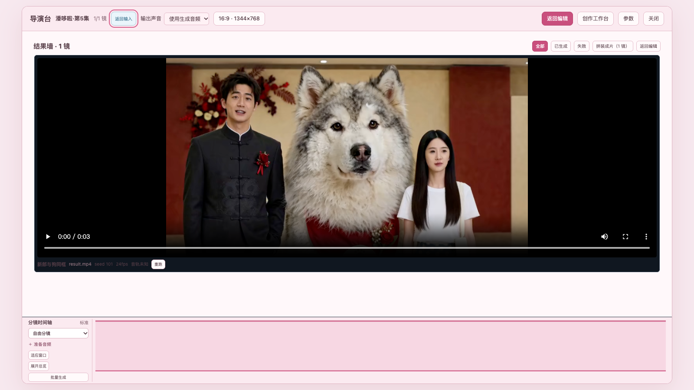

# ZDX Director Board for ComfyUI

The screenshots below render the **current Director Board frontend** in its
test harness, using the four supplied reference images and the supplied
[video result](https://oss.lingyanai.cn/x/prod/videos/admin_users/QwenEdit/27-10007590-20261111235525.mp4).
The result was attached to the harness for display; these screenshots do not
claim that this package generated the video. The sample scene is
“潘哆啦·第5集”, shot `s33`, with a 16:9 canvas and 24 fps output.

### Reference images bound to a shot

### Video in the result wall

Clone this repository into `ComfyUI/custom_nodes/ComfyUI-DirectorBoard` and
restart ComfyUI. The package is an early release candidate; review the
[validation status](VALIDATION.md) before relying on it for production runs.

Registered nodes: `ZDXDirectorBoard`, `ZDXH3ShotSelect`, and
`MiniMaxH3VideoShotSample`. `ZDXAssetGenerator` is deliberately excluded.

Do not install this package alongside `zdx_comfyui`: both register the same
node IDs and HTTP routes.

The package requires a ComfyUI build with MiniMax H3 nodes and matching H3
model weights. `ffmpeg` and `ffprobe` are needed for media previews. For the
optional writing assistant, set `DOUBAO_LLM_API_KEY` and optionally
`DOUBAO_LLM_ENDPOINT` and `DOUBAO_LLM_MODEL` in the ComfyUI environment.

The asset library and upload routes are included. Image generation through
`ZDXAssetGenerator` is not included. The asset caption route returns a clear
501 response until an independent caption provider is implemented.

The copied H3 sampling helpers are under the package root, rather than
depending on the original repository's `workflows` package. No model weights
or credentials are included.

See `VALIDATION.md` for current verification status and outstanding blockers.
